Senior DevSecOps engineer and cloud solutions architect, CCSP certified. I build open-source tooling for infrastructure and AI agents that decides what runs, in what order and with whose permission, and I write about both at [dortort.com](https://dortort.com).

**[Blog](https://dortort.com)** &nbsp;&nbsp; **[CV](https://dortort.com/cv/)**

 

<a href="https://github.com/stackorder/stackorder">
  <picture>
    <source media="(prefers-color-scheme: dark)" srcset="assets/stackorder-dark.svg">
    
  </picture>
</a>

Which stacks, in what order. Stackorder plans every Terraform or OpenTofu stack a pull request affects and applies them in dependency waves on your own GitHub Actions runners. Its server stores no state, and holds no cloud credentials unless you turn on shared outputs.

**[stackorder.io](https://stackorder.io)** &nbsp;&nbsp; **[Docs](https://docs.stackorder.io)** &nbsp;&nbsp; **[Source](https://github.com/stackorder/stackorder)**

 

<a href="https://github.com/dortort/wawarden">
  <picture>
    <source media="(prefers-color-scheme: dark)" srcset="assets/wawarden-dark.svg">
    
  </picture>
</a>

A self-hosted WhatsApp gateway for your own AI agents. WaWarden links one personal account, keeps its messages in a local archive, and exposes them over REST and MCP. Each client gets a token that reads only the chats on its allowlist.

**[Docs](https://wawarden.dortort.dev/)** &nbsp;&nbsp; **[Source](https://github.com/dortort/wawarden)**

 

<a href="https://github.com/dortort/claude-plugins/tree/main/plugins/taint-guard">
  <picture>
    <source media="(prefers-color-scheme: dark)" srcset="assets/taintguard-dark.svg">
    
  </picture>
</a>

A Claude Code mod that remembers which sensitive or untrusted sources have entered a session and refuses risky tool calls once they have. After Claude reads an `.env` file, `Bash`, `WebFetch` and outbound MCP tools are refused outright.

**[Source](https://github.com/dortort/claude-plugins/tree/main/plugins/taint-guard)** &nbsp;&nbsp; **[Why agent permissions need history](https://dortort.com/posts/safe-tools-unsafe-session-why-agent-permissions-need-history/)**

 

<a href="https://github.com/dortort/across-amazon">
  <picture>
    <source media="(prefers-color-scheme: dark)" srcset="assets/across-amazon-dark.svg">
    
  </picture>
</a>

A Chrome extension that finds the Amazon store that delivers a product to you for the lowest total: item, shipping and import fees.

**[Chrome Web Store](https://chromewebstore.google.com/detail/across-amazon/jipkoghidlgfmgoihpaecdnaapiniglc)** &nbsp;&nbsp; **[Website](https://across-amazon.dortort.dev)** &nbsp;&nbsp; **[Source](https://github.com/dortort/across-amazon)**

More open-source projects

 

<!-- CURRENT_PROJECTS_START -->
- [agent-bound](https://github.com/dortort/agent-bound) — Access control framework for MCP servers with Android-style permissions.
- [agentry](https://github.com/dortort/agentry) — Playwright for AI Agents — end-to-end testing for agent CLIs, MCP servers, and skills. Drive a real agent, assert on what it did, replay deterministically in CI.
- [ai-tool-guard](https://github.com/dortort/ai-tool-guard) — Policy enforcement middleware for AI SDK tool calls — guards, approvals, rate limiting, and observability.
- [betterleaks-action](https://github.com/dortort/betterleaks-action) — GitHub Action for Betterleaks secrets detection - scan for exposed credentials in your CI/CD pipeline.
- [dgossgen](https://github.com/dortort/dgossgen) — Generate dgoss container test suites from Dockerfiles via static analysis.
- [gemini-actions](https://github.com/dortort/gemini-actions) — A collection of GitHub Actions powered by Google Gemini that automate repository workflows.
- [keystone](https://github.com/dortort/keystone) — Open-source Electron app for AI-assisted software architecture (PRDs, TDDs, ADRs).
- [moovit-client](https://github.com/dortort/moovit-client) — TypeScript client library for Moovit public transit API (route planning, real-time arrivals, and location search).
- [openclaw-aws](https://github.com/dortort/openclaw-aws) — Infrastructure and deployment automation for OpenClaw on AWS.
- [openclaw-mailguard](https://github.com/dortort/openclaw-mailguard) — OpenClaw plugin for email prompt-injection mitigation with gated tool access.
- [skills](https://github.com/dortort/skills) — Reusable agent skills for AI tools.
- [TADBench](https://github.com/dortort/TADBench) — A unified benchmark for embedding-based threat detection in LLM prompts.
- [terraform-aws-mcpgateway](https://github.com/dortort/terraform-aws-mcpgateway) — Terraform module to deploy MCP Context Forge on AWS — ECS/EKS, Fargate/EC2, Aurora/MySQL, Redis, ALB+WAF.
<!-- CURRENT_PROJECTS_END -->

 

<a href="https://dortort.com">
  <picture>
    <source media="(prefers-color-scheme: dark)" srcset="assets/writing-dark.svg">
    
  </picture>
</a>

<!-- LATEST_WRITING_START -->
- [Safe Tools, Unsafe Session: Why Agent Permissions Need History](https://dortort.com/posts/safe-tools-unsafe-session-why-agent-permissions-need-history/) November 5, 2026
- [Agentic DevOps Security: Old IAM Failures at New Speed](https://dortort.com/posts/agentic-devops-security-old-iam-failures-at-new-speed/) August 2, 2026
- [Monorepo vs Multi-Repo: Why AI Agents Tip the Scale](https://dortort.com/posts/monorepo-vs-multi-repo-why-ai-agents-tip-the-scale/) May 20, 2026
- [Closing the automation gap in Claude Code](https://dortort.com/posts/closing-the-automation-gap-in-claude-code/) April 7, 2026
- [Beyond terraform_remote_state: five ways to share data across Terraform configurations](https://dortort.com/posts/beyond-terraform-remote-state-five-ways-to-share-data-across-configurations/) March 9, 2026
- [Don't Ditch AGENTS.md — Fix What's In It](https://dortort.com/posts/dont-ditch-agents-md-fix-whats-in-it/) February 24, 2026
<!-- LATEST_WRITING_END -->

Earlier articles

 

<!-- EARLIER_WRITING_START -->
- [Agentic AI is reintroducing ClickOps](https://dortort.com/posts/agentic-operations-clickops/) February 21, 2026
- [dgoss: Testing the Container, Not Just the Image](https://dortort.com/posts/runtime-contract-tests-with-dgoss/) January 8, 2026
- [A Practical Guide to Terraform Dependency Management](https://dortort.com/posts/terraform-version-constraints/) August 4, 2025
- [Stop Scripting, Start Architecting: The OOP Approach to Terraform](https://dortort.com/posts/stop-scripting-start-architecting-terraform-oop/) July 2, 2025
- [Why GitFlow Fails at Infrastructure](https://dortort.com/posts/terraform-strategy-gitflow-vs-trunk-based/) June 4, 2025
- [Modernizing Scheduled Tasks: Reliability, Scale, and Zero Maintenance](https://dortort.com/posts/building-serverless-cron-on-aws/) May 6, 2025
- [How Serverless Shrinks PCI Scope](https://dortort.com/posts/serverless-pci-dss-scope-reduction/) April 3, 2025
- [Terraform at Scale: Folders, Workspaces, or Services?](https://dortort.com/posts/structuring-terraform-for-multi-environment-microservice-architectures/) March 4, 2025
- [Kubernetes vs. Proprietary Container Services: A Technical and Pragmatic Comparison](https://dortort.com/posts/kubernetes-vs-proprietary-container-services/) February 10, 2025
- [Idempotent Dockerfiles: Desirable Ideal or Misplaced Objective?](https://dortort.com/posts/idempotent-dockerfiles/) January 15, 2025
<!-- EARLIER_WRITING_END -->

